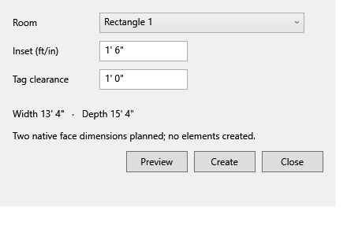
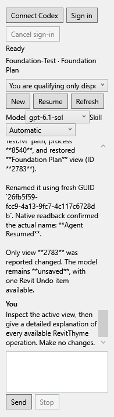
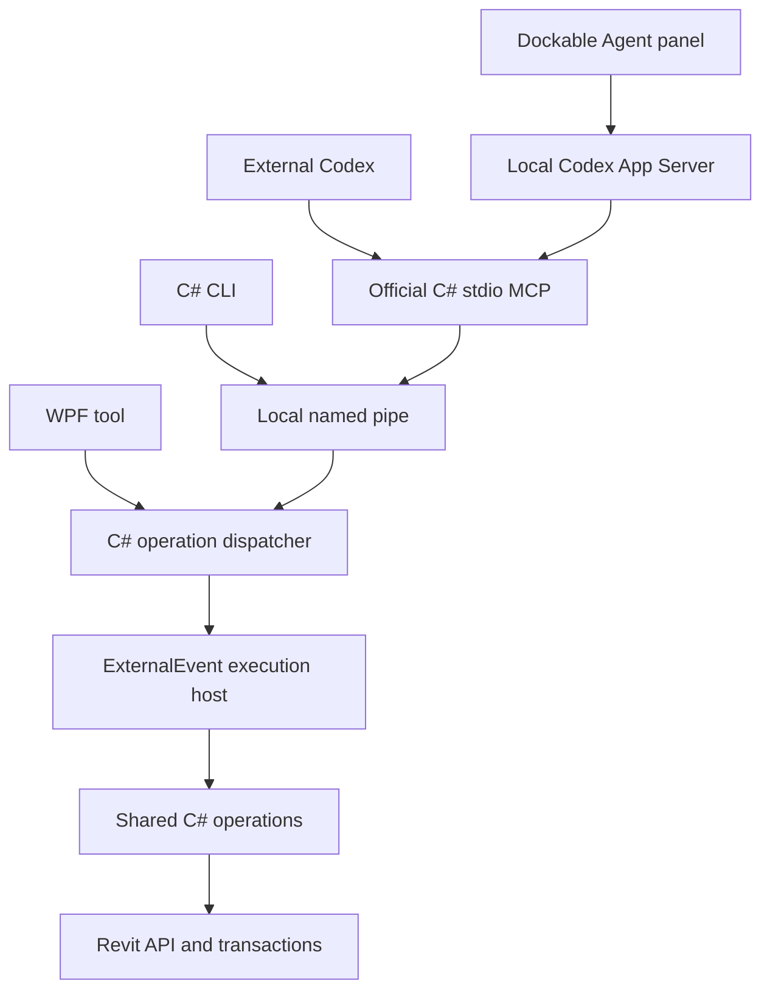

# RevitThyme


RevitThyme is an open-source native Revit toolkit. Its shared C# operation layer serves WPF, CLI, external AI through MCP and an optional built-in Codex Agent.

This checkout implements **Foundation, MCP, Native utilities, Dynamic execution and Built-in Agent** from the [2026-10-14 plan](2026-10-14_NEW_PLAN.md). **View Range** edits the four native plan planes with a section preview. **Room Dimensions** creates an associative width/depth pair for rectangular rooms, leaving room for tags. Both work through native ribbon buttons, CLI and MCP using shared C# operations and one Revit Undo item per edit. The official C# MCP server exposes 18 tools, including opt-in trusted Roslyn C# query/modify. Native tools work without an AI account, Rust, Electron or pyRevit.





## Install

Close Revit normally, preserving unsaved work, then run this in PowerShell to install the latest stable release:

```powershell
irm https://revitthyme.wlkrlabs.com/install | iex
```

To install **v0.9.0** specifically, use `irm https://github.com/scwlkr/RevitThyme/releases/download/v0.9.0/install.ps1 | iex`. The older `/install-0.8.1` command remains pinned to 0.8.1.

The bootstrap downloads and verifies the Windows installer before running it. Version 0.9.0 bundles the add-in, CLI, MCP and built-in Agent with the official Codex runtime. Only full Revit 2027 is supported. End users need its .NET 10 runtime and Windows PowerShell 5.1; installation requires no SDK or administrator permission. The installer is unsigned. Piping to `iex` trusts the script served by this domain and its GitHub release source; you can inspect it first or download the [v0.9.0 installer](https://github.com/scwlkr/RevitThyme/releases/download/v0.9.0/RevitThyme-0.9.0-win-x64.exe) and [SHA-256](https://github.com/scwlkr/RevitThyme/releases/download/v0.9.0/RevitThyme-0.9.0-win-x64.exe.sha256) directly. See [installation and recovery](docs/INSTALLATION.md).

RevitThyme checks for updates once a day in the background. **Check for Updates** on the ribbon checks immediately and can download a verified installer. During development, use `project.cmd cli --version`, `project.cmd cli update check --json`, or `project.cmd cli update install` with Revit closed. See [update commands](docs/UPDATES.md).

## Build

Use Windows, PowerShell 7, .NET SDK 10.0.400 and licensed Revit 2027. The current native target is Revit **27.3.0.28**; other releases and another computer need qualification. Revit supplies its proprietary API assemblies locally.

```powershell
.\project.cmd doctor
.\project.cmd check
.\project.cmd package
```

The last command prints a package folder and checksum. `project.cmd setup -PackageDirectory $package` compiles a single Windows installer from that folder. See [installation, bootstrap and recovery](docs/INSTALLATION.md), [installer verification](verification/installation.md) and [utility usage and limits](docs/NATIVE-UTILITIES.md). Close Revit normally before installing.

For CLI automation, inspect a chosen session into a private JSON capture, review it, then rename the exact captured view. See `project.cmd cli --help`. A successful rename creates one Revit Undo item; the tool never saves or syncs a project.

## Architecture



See [architecture](docs/ARCHITECTURE.md), [MCP tools and Codex setup](docs/MCP.md), [Foundation evidence](verification/foundation.md), [MCP verification](verification/mcp.md) and [Native utilities verification](verification/native-utilities.md). Hosted CI builds the portable C#/WPF/MCP solution and runs offline checks. Real Revit tests use a new, pinned disposable process and populated fixture.

[Trusted C# execution](docs/DYNAMIC-EXECUTION.md) uses rollback queries, atomic modifications, structured diagnostics/results and retained request outcomes. It is disabled by default and runs with full process permissions. The independent [Cabin Eval](tests/CabinEval/README.md) scores actual native results, including a temporary 14-to-18-foot length probe, in a new disposable process/model. See [Dynamic execution verification](verification/dynamic-execution.md).

The [built-in Agent](docs/AGENT.md) adds a dockable Codex chat panel, ChatGPT sign-in, saved conversations and ordinary skills, pinned to the current Revit process. The 0.9.0 installer bundles the official Codex runtime. See [Agent verification](verification/agent.md). Exploration remains deferred. Superseded source and evidence are preserved in [legacy/pre-foundation](legacy/README.md); earlier qualification does not certify this new product. Existing installed tools and external TimberFold remain preserved.

## Contribute

Small tools and clear bug reports are welcome. Start with [CONTRIBUTING.md](CONTRIBUTING.md). Public contributors need no Linear account or Codex runtime knowledge. The [issue templates](.github/ISSUE_TEMPLATE) collect small reproducible examples; [starter labels](.github/labels.json) describe contribution categories.

GPL-3.0-or-later. See [LICENSE](LICENSE), [third-party notices](THIRD-PARTY-NOTICES.md) and [security](SECURITY.md). Revit is supplied and licensed separately; Autodesk binaries are excluded from source packages.
