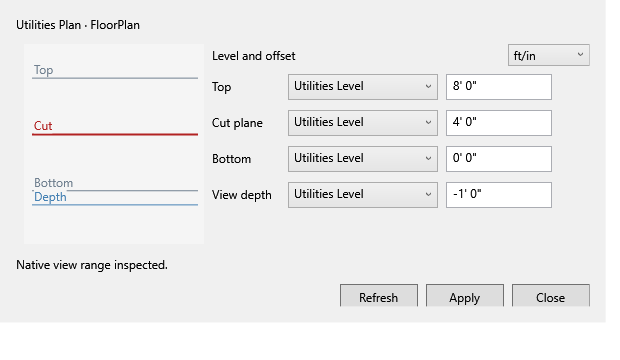

# RevitThyme


Open-source C# tools for Revit 2027. Use TimberFold, View Range and Room Dimensions from the ribbon, or shared operations through the CLI and MCP. The optional docked Agent uses Codex; native tools need no AI account.

[](https://github.com/scwlkr/RevitThyme/actions/workflows/ci.yml)
[](https://github.com/scwlkr/RevitThyme/actions/workflows/website.yml)
[](https://github.com/scwlkr/RevitThyme/releases/latest)
[](LICENSE)

[Website](https://revitthyme.wlkrlabs.com) · [Documentation](docs/INDEX.md) · [Install](docs/INSTALLATION.md) · [Contribute](CONTRIBUTING.md) · [Changelog](CHANGELOG.md)

## What you can do

| Tool | What it helps you do |
| --- | --- |
| **View Range** | Edit four native plan planes with a section preview, feet/inches or metric entry, template guards and one Undo. |
| **Room Dimensions** | Preview and create an associative width/depth pair for a rectangular room with native finish references and room-tag clearance. |
| **Inspection and editing** | Inspect views, elements and typed parameters; rename views and apply expected-value parameter batches with verified native readback. |
| **TimberFold** | Turn supported planar exterior walls and roofs into DWG/DXF cutting kits, source-mapped guides and native review sheets. Digital verification is complete; physical fabrication remains outstanding. |
| **CLI and MCP** | Use shared operations through `rthyme` and local MCP with explicit targeting and outcome recovery. Published v0.10.0 has 25 tools; source adds unreleased native image export and five explicit document/view-lifecycle tools (31 total). |
| **Built-in Agent** | Work from an optional dockable Codex panel with ChatGPT sign-in, saved conversations, approvals and skills. |



See [all features and limits](FEATURES.md), [native tools](docs/NATIVE-UTILITIES.md) and [agent integration](docs/AGENT-INTEGRATION.md). Trusted C# execution is a separate opt-in, runs with full process permissions and is not sandboxed.

## Install

Save your work and close Revit normally. In PowerShell:

```powershell
irm https://revitthyme.wlkrlabs.com/install | iex
```

Requires **Windows x64, full Revit 2027 and .NET 10 runtimes**. No SDK or administrator permission is needed. Revit LT and other Revit years are unsupported. Open a new terminal after setup, run `rthyme --version`, then follow [first steps](docs/QUICK-START.md).

The installer is **unsigned**. The bootstrap verifies downloaded installer checksums; piping to `iex` trusts the served script and GitHub release source. Inspect the script or manually download the installer and adjacent SHA-256 from [GitHub Releases](https://github.com/scwlkr/RevitThyme/releases/latest). See [installation and recovery](docs/INSTALLATION.md).

For **v0.10.0**, download the [Windows setup](https://github.com/scwlkr/RevitThyme/releases/download/v0.10.0/RevitThyme-0.10.0-win-x64.exe) and [small TimberFold physical-test kit](https://github.com/scwlkr/RevitThyme/releases/download/v0.10.0/TimberFold-physical-test.zip). The test ZIP includes calibration pieces, an original editable gable RVT, six-panel cutting files and guides. Read its instructions and [physical limits](docs/timberfold/delivery.md) before cutting; `ManufacturingReady` remains false.

RevitThyme is **pre-1.0**. Native qualification targets Revit **27.3.0.28** on the recorded test host; other builds and computers need qualification. [Verification records](verification/README.md) distinguish offline, package and actual-Revit evidence.

## Build and contribute

Documentation contributions need Node.js 22 or newer (Node 24 in CI). Portable C# development needs Windows, PowerShell 7 and the SDK pinned in [global.json](global.json); it does not need Revit or proprietary API binaries.

```powershell
git clone https://github.com/scwlkr/RevitThyme.git
cd RevitThyme
.\project.cmd check -Portable
```

For the website:

```powershell
cd website
npm ci
npm start
```

The preview runs at `http://127.0.0.1:3100`. Website content comes from repository Markdown; edit original files, not generated copies. [Website maintenance](docs/WEBSITE.md) explains the checks that keep content aligned.

Full add-in builds and live tests require licensed Revit 2027 and local Autodesk API assemblies. Follow [isolated development](docs/DEVELOPMENT.md); use a pinned disposable process and fixture. Never use a working model as a test fallback.

[Contributing](CONTRIBUTING.md) · [Architecture](docs/ARCHITECTURE.md) · [Roadmap](docs/ROADMAP.md) · [Support](SUPPORT.md) · [Code of conduct](CODE_OF_CONDUCT.md) · [Security](SECURITY.md)

A [WLKR LABS](https://github.com/scwlkr) project, licensed **GPL-3.0-or-later**. Autodesk Revit is supplied and licensed separately. Independent software; not affiliated with or endorsed by Autodesk. See [third-party notices](THIRD-PARTY-NOTICES.md).
