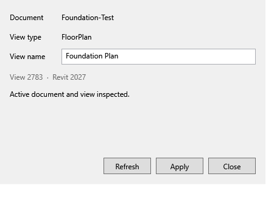
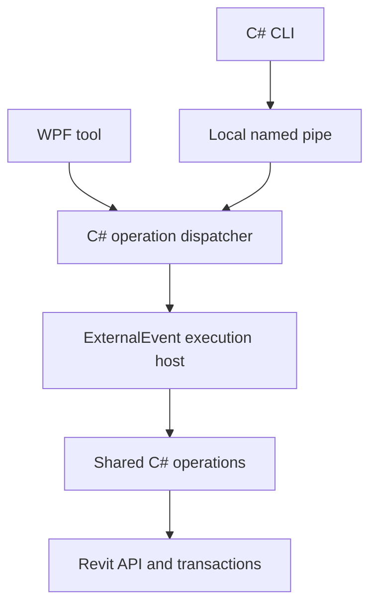

# RevitThyme


RevitThyme is an open-source native Revit toolkit. Its C# operation layer serves a WPF interface and CLI; AI interfaces are optional later stages.

This checkout implements **Foundation only** from the [2026-10-14 plan](2026-10-14_NEW_PLAN.md). The native **Inspect View** tool reads the active document/view and renames the captured view through a verified, undoable transaction. WPF and CLI use the same operations. No AI account, Rust, Electron or pyRevit is required.



## Build and install

Use Windows, PowerShell 7, .NET SDK 10.0.400 and licensed Revit 2027. The current native target is Revit **27.3.0.28**; other releases and another computer need qualification. Revit supplies its proprietary API assemblies locally.

```powershell
.\project.cmd doctor
.\project.cmd check
.\project.cmd package
```

The last command prints a package folder and checksum. Close Revit normally and run `install.ps1` in that folder, then open **RevitThyme → Foundation → Inspect View**. See [installation and recovery](docs/INSTALLATION.md). This foundation has a reversible local installer; a signed production `.exe` and release bootstrap remain distribution work.

For CLI automation, inspect a chosen session into a private JSON capture, review it, then rename the exact captured view. See `project.cmd cli --help`. A successful rename creates one Revit Undo item; the tool never saves or syncs a project.

## Architecture



See [architecture](docs/ARCHITECTURE.md), [Foundation acceptance](docs/FOUNDATION.md) and [verification](verification/foundation.md). Hosted CI builds the portable C#/WPF solution and runs offline checks. Real Revit tests use a new, pinned disposable process and fixture.

MCP, full View Range/Room Dimensions migration, dynamic C#, Cabin Eval, Codex Agent and exploration remain [later stages](docs/ROADMAP.md). Superseded source and evidence are preserved in [legacy/pre-foundation](legacy/README.md); earlier qualification does not certify this new product. Existing installed tools and external TimberFold remain preserved.

## Contribute

Small tools and clear bug reports are welcome. Start with [CONTRIBUTING.md](CONTRIBUTING.md). Public contributors need no Linear account or Codex runtime knowledge. The [issue templates](.github/ISSUE_TEMPLATE) collect small reproducible examples; [starter labels](.github/labels.json) describe contribution categories.

GPL-3.0-or-later. See [LICENSE](LICENSE), [third-party notices](THIRD-PARTY-NOTICES.md) and [security](SECURITY.md). Revit is supplied and licensed separately; Autodesk binaries are excluded from source packages.
