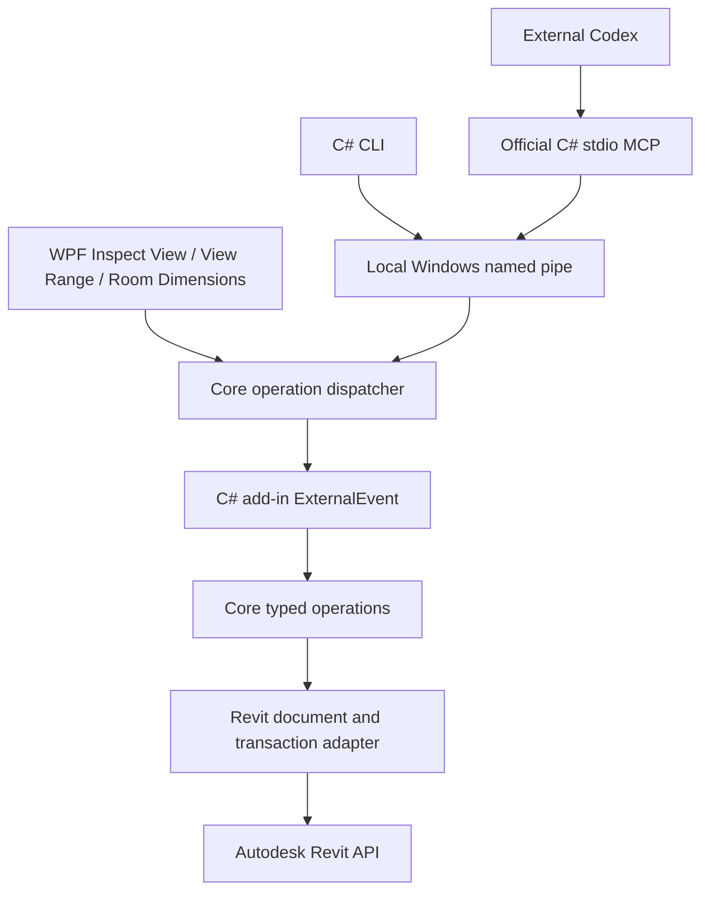

# C# Native toolkit

The accepted architecture is [the complete 2026-10-14 plan](../2026-10-14_NEW_PLAN.md). This implementation stops at its Dynamic execution row. Native tools work without an AI runtime.

`src/RevitThyme.Core` owns requests, results, target checks, the serialized queue, transaction orchestration and IPC contracts. It references no Autodesk assemblies or UI framework. `RevitThyme.Addin` supplies the native document adapter, ribbon, ExternalEvent and transaction implementation. `RevitThyme.UI` is a modeless WPF window using `IOperationClient`. `RevitThyme.Cli` is another client of those same operations; it contains no model-changing implementation.

`RevitThyme.Mcp` adapts the official SDK's stdio transport and schemas to those same Core requests. It serializes connection changes/calls and issues bounded, connection-local capture IDs. A rename requires captured process/start, session, open document identity, view UniqueId, revision and previous name. Generic reads and writes validate the same target. Revit events invalidate captures; reopening creates a new document identity. Parameter edits require exact prior raw values and parameter IDs, and share the native transaction wrapper with rename. Before/after native readback precedes group assimilation into one Undo item. Failures roll back; uncertain completion reports an unconfirmed outcome. Selection is separately verified UI state.

The bridge uses a session-specific Windows named pipe restricted to the current user's SID, rejects remote clients, verifies the server's OS process ID and uses size-bounded framed JSON. Protocol version 4 adds trusted C# contracts; upgrade add-in/CLI/MCP together. The dispatcher retains up to 4,096 outcomes per session, compares replay arguments by value and rejects conflicting IDs. `get_operation` can read retained results without waiting for an API callback. Cancellation prevents queued work from executing; running work finishes and retains its outcome. All model access runs in Revit API callbacks. Typed operations do not implicitly save or synchronize a model.

Utilities implement `IUtilityModel` and `IUtilityChange`: Core checks captured identity, expected native range/room preview and transaction outcomes; Addin resolves Revit planes, finish-face references, tag bounds and native dimensions. Room plans are recomputed and compared by value before any write. The WPF/CLI/MCP adapters contain no duplicate model-editing implementation. Existing legacy ribbon panels are reused with distinct native command IDs.

## Scope and compatibility

The first build targets .NET 10 and Revit 2027. Revit 2027 uses [.NET 10](https://blog.autodesk.io/revit-2027-sdk-net-10-api-changes-and-additions/); a promise of Revit 2025+ support would need separate per-release builds and qualification. Local SDK references have CopyLocal disabled. Public builds never fetch or redistribute Autodesk binaries.

Roslyn compilation lives in Addin; Core validates captured targets, trust and request bounds without referencing Autodesk or Roslyn. The compiler is source-linked into portable tests to exercise the exact implementation. Submissions load into collectible contexts sharing the native API assembly identity. Query rolls back; modify uses the existing native transaction wrapper, captures DocumentChanged IDs and assimilates one Undo. Results serialize inside the reversible group. Host launch opt-in plus caller trust are required. Full process privileges, cooperative budgets and limitations are documented in [Dynamic execution](DYNAMIC-EXECUTION.md). The independent [Cabin Eval](../tests/CabinEval/README.md) is compiled into the disposable test loader and never packaged with the product.

The built-in Codex client and planning graphics remain later stages. External Codex launches the MCP directly; this stage does not implement App Server integration, reflection discovery, planning canvases or an agent framework.

Superseded Rust, Electron and pyRevit implementation and earlier evidence live in `legacy/pre-foundation`. Existing installed bundles and private `artifacts` are preserved. That archive is outside the solution, CI and package allowlist; see [migration](MIGRATION.md).
