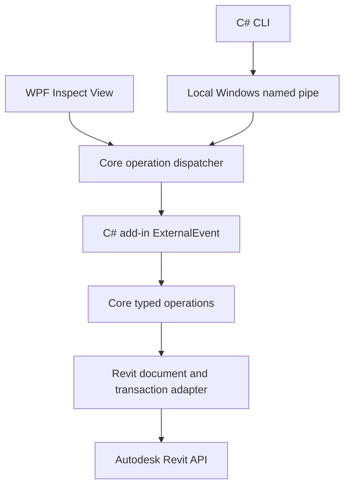

# C# Foundation

The accepted architecture is [the complete 2026-10-14 plan](../2026-10-14_NEW_PLAN.md). This implementation stops at its Foundation row. RevitThyme works without an AI runtime.

`src/RevitThyme.Core` owns requests, results, target checks, the serialized queue, transaction orchestration and IPC contracts. It references no Autodesk assemblies or UI framework. `RevitThyme.Addin` supplies the native document adapter, ribbon, ExternalEvent and transaction implementation. `RevitThyme.UI` is a modeless WPF window using `IOperationClient`. `RevitThyme.Cli` is another client of those same operations; it contains no model-changing implementation.

Only `Inspect` and `RenameView` are registered. A rename requires the captured process ID/start time, session, open document identity, active view UniqueId, model revision and previous name. Revit events invalidate captures after document/view changes; reopening a file creates a new document identity. A successful rename verifies the native value before and after commit, then assimilates a transaction group into one Undo item. Native failures roll back; an unverified rollback or disconnected submitted edit reports an unconfirmed outcome. The client never automatically repeats edits.

The bridge uses a session-specific Windows named pipe restricted to the current user's SID, rejects remote clients, verifies the server's OS process ID and uses size-bounded framed JSON. Requests contain data, not executable code. The dispatcher retains request outcomes for the session and rejects conflicting IDs. WPF and pipe callers enqueue work; all model access runs in Revit API callbacks. No model is implicitly saved or synchronized.

## Scope and compatibility

The first build targets .NET 10 and Revit 2027. Revit 2027 uses [.NET 10](https://blog.autodesk.io/revit-2027-sdk-net-10-api-changes-and-additions/); a promise of Revit 2025+ support would need separate per-release builds and qualification. Local SDK references have CopyLocal disabled. Public builds never fetch or redistribute Autodesk binaries.

MCP, Codex client, Room Dimensions, full View Range, Roslyn execution, Cabin Eval and planning graphics are later stages. Their intended project names are reserved in the roadmap; empty executable projects and fake tool registrations have not been added. Future adapters must call these shared operations.

Superseded Rust, Electron and pyRevit implementation and earlier evidence live in `legacy/pre-foundation`. Existing installed bundles and private `artifacts` are preserved. That archive is outside the solution, CI and package allowlist; see [migration](MIGRATION.md).
