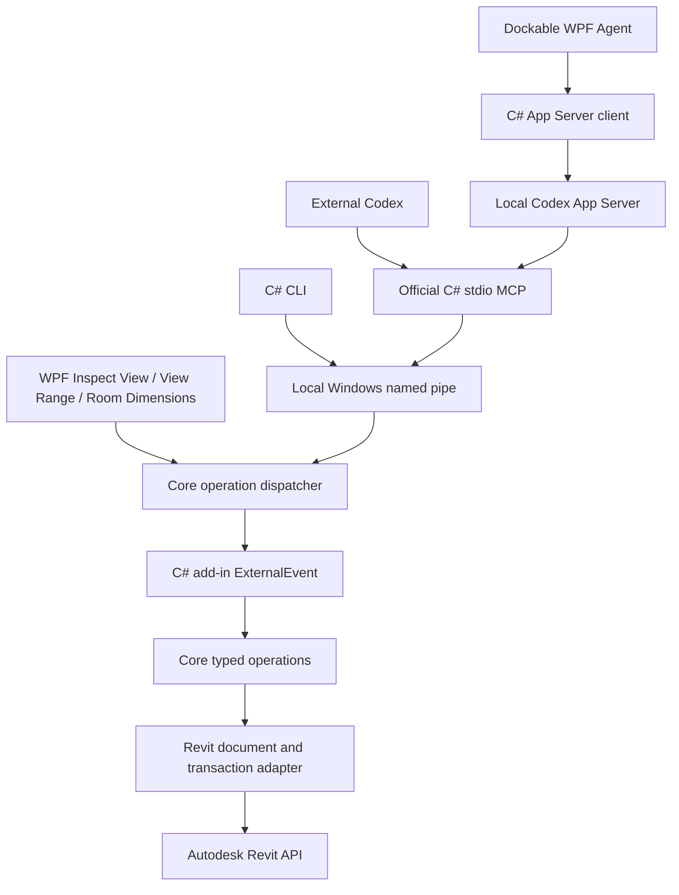

# C# Native toolkit

Ribbon tools, CLI, MCP and the optional built-in Agent share typed operations and a native execution host. The [original architecture plan](../2026-10-14_NEW_PLAN.md) records the design history. Native tools work without an AI runtime; the [project overview](../PROJECT.md) describes current scope.

`src/RevitThyme.Core` owns requests, results, target checks, the serialized queue, transaction orchestration and IPC contracts. It references no Autodesk assemblies or UI framework. `RevitThyme.Addin` supplies the native document adapter, ribbon, ExternalEvent and transaction implementation. `RevitThyme.UI` is a modeless WPF window using `IOperationClient`. `RevitThyme.Cli` is another client of those same operations; it contains no model-changing implementation.

Published v0.10.0 uses protocol 8 and includes qualified TimberFold inspection, retained preview/generation runs and reconciliation; see [qualification](timberfold/qualification.md). The unreleased lifecycle candidate uses protocol 13 and adds Home-aware background open, exact document/view activation, active-document save and clean close with explicit active-document handoff outside model transactions, with verified Completed outcomes and retained recovery. Active close requires an explicit already-open clean handoff target; last-document close to Home is rejected before side effects. GetOperation uses an independent process-verified pipe and the existing dispatcher history, so outcome polling does not wait for the ordinary native operation pipe. Native extraction and image export run inside captured Revit callbacks. Full extraction snapshots and image files remain private; the bridge returns bounded summaries and file metadata. Inspection and image export open no model transaction and never save the source, but their evidence-file writes use retained-request recovery and are declared in MCP annotations. All host/CLI/MCP clients must use the matching protocol.

`ExportViewImage` adds one `IViewImageModel` operation to the existing dispatcher. A fresh captured target and explicit view UniqueId select exactly one native view/sheet; `SetOfViews` avoids activation and caller-owned callbacks. The native adapter decodes/hashes the PNG and Core verifies unchanged before/after context. The MCP adapter reads and rehashes the retained file before returning an inline image, including on `get_operation` recovery. Original request retention, conflict checks and queued cancellation remain shared. No second scheduler, save operation, lifecycle operation or promotion mechanism is introduced.

`RevitThyme.Mcp` adapts the official SDK's stdio transport and schemas to those same Core requests. It serializes connection changes/calls and issues bounded, connection-local capture IDs. A rename requires captured process/start, session, open document identity, view UniqueId, revision and previous name. Generic reads and writes validate the same target. Revit events invalidate captures; reopening creates a new document identity. Parameter edits require exact prior raw values and parameter IDs, and share the native transaction wrapper with rename. Before/after native readback precedes group assimilation into one Undo item. Failures roll back; uncertain completion reports an unconfirmed outcome. Selection is separately verified UI state.

The bridge uses a session-specific Windows named pipe restricted to the current user's SID, rejects remote clients, verifies the server's OS process ID and uses size-bounded framed JSON. Upgrade add-in/CLI/MCP together. The dispatcher retains up to 4,096 outcomes per session, compares replay arguments by value and rejects conflicting IDs. `get_operation` reads that same retained history through a separate process-verified outcome pipe, without a new API callback or waiting for the original request's pipe. Cancellation prevents queued work from executing; running work finishes and retains its outcome. All model access runs in Revit API callbacks. Typed operations do not implicitly save or synchronize a model.

Parameter inspection and readback share `ParameterInfo`, including native shared status/GUID, built-in enum identity and `HasValue`. Updated clients request this response metadata through the existing bridge envelope's optional `includeParameterIdentity` flag. Older version-4 clients omit the flag and receive the original parameter shape, because their strict decoders reject unknown members. This projection happens only at response serialization; cached results, request equality, exact-ID edits and validation stay unchanged. Session discovery and the protocol version remain unchanged. Install updated Addin/CLI/MCP together; older hosts do not recognize the response flag.

Utilities implement `IUtilityModel` and `IUtilityChange`: Core checks captured identity, expected native range/room preview and transaction outcomes; Addin resolves Revit planes, finish-face references, tag bounds and native dimensions. Room plans are recomputed and compared by value before any write. The WPF/CLI/MCP adapters contain no duplicate model-editing implementation. Existing legacy ribbon panels are reused with distinct native command IDs.

## Scope and compatibility

The first build targets .NET 10 and Revit 2027. Revit 2027 uses [.NET 10](https://blog.autodesk.io/revit-2027-sdk-net-10-api-changes-and-additions/); a promise of Revit 2025+ support would need separate per-release builds and qualification. Local SDK references have CopyLocal disabled. Public builds never fetch or redistribute Autodesk binaries.

Roslyn compilation lives in Addin; Core validates captured targets, trust and request bounds without referencing Autodesk or Roslyn. The compiler is source-linked into portable tests to exercise the exact implementation. Submissions load into collectible contexts sharing the native API assembly identity. Query rolls back; modify uses the existing native transaction wrapper, captures DocumentChanged IDs and assimilates one Undo. Results serialize inside the reversible group. Host launch opt-in plus caller trust are required. Full process privileges, cooperative budgets and limitations are documented in [Dynamic execution](DYNAMIC-EXECUTION.md). The independent [Cabin Eval](../tests/CabinEval/README.md) is compiled into the disposable test loader and never packaged with the product.

`RevitThyme.Codex` owns the JSON-RPC stdio process, correlated requests, server events, account/session/skill calls and turn lifecycle. It has no Autodesk or WPF dependency. The UI presents conversations, streamed replies, native tool results and approvals in a dockable pane. The add-in supplies an exact process/session binding. The Agent owns a separate Codex home, configuration, history and authentication; only its pinned MCP server is exposed. Codex handles inference, authentication and orchestration. See [Agent](AGENT.md).

External Codex still launches the same MCP directly. Optional visual planning, reflection discovery and the Exploration experiment remain deferred.

Superseded Rust, Electron and pyRevit implementation and earlier evidence live in `legacy/pre-foundation`. Existing installed bundles and private `artifacts` are preserved. That archive is outside the solution, CI and package allowlist; see [migration](MIGRATION.md).
