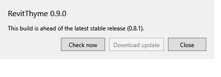

# v0.9.0 update checker verification

User scope: add daily/manual release checks and development CLI controls, then publish the completed Agent in v0.9.0. Exploration remains deferred.

The shared C# checker reads the official stable GitHub release and bounded metadata, validates exact release asset URLs and supported Revit years, and distinguishes available/current/ahead/incompatible versions. Native startup records its daily attempt before networking and stays quiet on failure. The UI and CLI pin the existing packaged PowerShell bootstrap to the checked version. Its installer/hash validation remains the single download implementation.

## Source and offline checks

- `project.cmd check`: 130 Core/CLI checks, 35 MCP checks and 13 Agent checks; zero failures. New checks cover newer/equal/older versions, incompatible Revit, invalid release metadata/assets/digests, redirect/HTTP/size faults, cancellation, daily cache concurrency/retry and CLI pinning/no-downgrade behavior.
- Real CLI `version --json` identifies 0.9.0 and the source commit. Before publication, `update check --json` correctly reported `ahead` of public 0.8.1. `update install` refused while the working Revit processes were open.
- Real CLI `update download --version 0.8.1 --destination <private folder>` ran Windows PowerShell 5.1 and verified the public installer. Reset the child's inherited `PSModulePath` so a caller running PowerShell 7 cannot hide Windows PowerShell's built-in hash commands. A second download succeeded with inherited Restricted execution policy using the installer's existing process-only policy argument; machine settings were unchanged. Both downloaded installer hashes matched `c74c4f6a228911f4dae5a822a22109948aae06993b74dc9799506366076696f9`.
- `check-bootstrap`: 174 checks each under PowerShell 7.6.5 and Windows PowerShell 5.1.26100.9711. Eighteen package/install checks and fourteen actual isolated setup/install/uninstall checks passed; native registrations remained untouched. Clean release metadata and executable identity are separate publication gates.

## Actual Revit

Final run `artifacts/agent/live/126cb059-84ea-4948-8d1e-95fbc59aecd5`, Revit 27.3.0.28, owned PID 24736: **11 passed** after the PowerShell policy correction. The earlier eleven-check run is also retained. The native loader is inert without its pinned test environment and excluded from distribution.

- Registered the native ribbon command and opened its owned WPF update window. A manual check used real public release metadata and correctly disabled downloads for the development build ahead of 0.8.1.
- Simulated an available release in the test-only loader to exercise the notice, close-first instructions and download action against the real public 0.8.1 installer. This simulation does not claim that 0.8.1 is newer than 0.9.0.
- Downloaded and verified the installer without installation, leaving Revit running. Recorded the daily startup attempt in an isolated cache.
- Preserved all 2,425 fixture elements, its saved SHA-256 `c01f5b51348a6d457b40796e699e3aa299b9d4a9404a7d07d05581b50d2ca704`, and its unmodified state.
- Cleanup stopped only the owned test process, restored the original registration by hash, and verified working PIDs 30992 and 35960 remained intact.

The loaded candidate was built on base `2b0eee513a66a7e46bf6b4c1ff87f8d5d79398d8` with the update changes. Its exact bundle hashes are retained in `plan.json`. Publication requires comparing executable metadata/IL with the final clean release build; assembly source-commit metadata changes on commit.

Built-in Agent has separate [17-check actual-Revit qualification](agent.md). This update change preserves that client/runtime and shares its installer package. The installer remains unsigned and Revit 2027 only. Installation on another computer and additional Revit versions remain unqualified. No working model was used for testing, saved, closed or synchronized.
